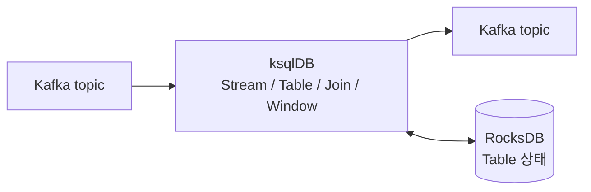

# ksqlDB로 증권사 실시간 데이터 처리하기 정리

2026년 10월 15일 오전 9:02

출처: [ksqlDB로 증권사 실시간 데이터 처리하기](https://toss.tech/article/ksqldb-realtime-data) (토스증권)

아래 SQL 예시는 원문 요약을 바탕으로 직접 작성한 것이다.
원문 쿼리 그대로가 아니며, 토픽·컬럼 이름은 가정이다.

## 1. 배경

- 토스증권 Realtime Data Team은 Kafka, Kafka Connect, ClickHouse,
  ksqlDB로 실시간 이벤트 플랫폼을 운영한다.
- 계좌개설 이벤트가 크게 성공하며 트래픽이 급증했고,
  플랫폼 운영자는 1명이었다.
- 요구사항
  - 토스 앱 안의 증권 탭 동시 접속자 실시간 확인
  - 환율 데이터 정합성 감시
  - 매매 정지 계좌의 주문 감지

## 2. ksqlDB란

원문에는 ksqlDB 자체의 설명이 없고, 아래는 일반적으로 알려진 내용이다.

**ksqlDB는 Kafka 토픽의 데이터를 SQL로 실시간 처리하는 엔진이다.**
Confluent가 만든 오픈소스이며 Kafka Streams 위에서 동작한다.

- 입력: Kafka 토픽
- 처리: SQL로 작성한 필터, 변환, 집계, Join, Window
- 출력: 다른 Kafka 토픽

### 일반 DB의 SQL과 차이

MySQL 같은 DB의 SELECT는 한 번 실행되고 끝난다. ksqlDB에 제출한
쿼리는 종료되지 않고 계속 실행되면서, 새 데이터가 들어올 때마다
결과를 갱신해 출력 토픽에 쓴다.

### 사용 예시

서버에 아래 SQL을 한 번 제출하면 이후 계속 실행된다.

```sql
-- 결제 금액이 100만원 이상인 건만 골라 다른 토픽에 계속 쓴다
CREATE STREAM big_payment AS
SELECT payment_id, user_id, amount
FROM payment
WHERE amount >= 1000000
EMIT CHANGES;
```

```text
payment 토픽:
  {결제1, 5천원} {결제2, 200만원} {결제3, 3만원}
      ↓ ksqlDB가 계속 실행
big_payment 토픽:
  {결제2, 200만원}
```

### 구성 요소

- ksqlDB 서버: SQL을 받아 실행하는 서버. 여러 대로 클러스터를 구성한다.
- Kafka 클러스터: 입력과 출력 데이터를 저장한다.
- 쿼리 제출 도구: ksql CLI, REST API, 웹 UI 등. 서버의 REST API를
  호출한다.

Stream, Table, Window 같은 핵심 개념은 5장에서 설명한다.

## 3. ksqlDB를 선택한 이유

후보: Spark Streaming, Flink, ksqlDB

| 이유 | 내용 |
| --- | --- |
| 생산성 | 코드 없이 SQL만으로 Job 작성. 글쓴이 평가로 10배 이상 |
| 운영 단순성 | Spark Streaming은 Job이 늘수록 운영 부담이 커졌음 |
| Kafka 적합성 | Offset 관리, H/A를 Kafka에 위임 |

### 코드 없이 SQL만으로 Job 작성한다는 것

"Job"은 Kafka 토픽의 데이터를 계속 읽어 처리하고 결과를 다른 토픽에
쓰는 프로그램이다. 보통은 Java나 Scala로 작성해 빌드하고 배포한다.
ksqlDB에서는 SQL을 서버에 제출하면 서버가 그 Job을 대신 실행한다.

예시: 30초마다 접속자 수 집계

코드로 작성할 때 (Kafka Streams, Java)

```java
StreamsBuilder builder = new StreamsBuilder();
builder.stream("client_log", Consumed.with(Serdes.String(), jsonSerde))
    .groupBy((k, v) -> v.getHostname())
    .windowedBy(TimeWindows.ofSizeWithNoGrace(Duration.ofSeconds(30)))
    .aggregate(HashSet::new,
        (host, v, set) -> { set.add(v.getUserId()); return set; },
        Materialized.with(Serdes.String(), setSerde))
    .toStream()
    .mapValues(Set::size)
    .to("concurrent_users");
new KafkaStreams(builder.build(), props).start();
```

이 코드 외에 필요한 작업

- 프로젝트 생성, 의존성 설정
- Serde(직렬화) 클래스 작성
- 빌드, 도커 이미지 생성, 배포
- Job마다 프로세스 운영과 모니터링

ksqlDB로 작성할 때

```sql
CREATE TABLE concurrent_users AS
SELECT hostname, COUNT_DISTINCT(user_id) AS users
FROM client_log
WINDOW TUMBLING (SIZE 30 SECONDS)
GROUP BY hostname
EMIT CHANGES;
```

- 빌드와 배포 과정이 없다.
- 서버가 이 쿼리를 계속 실행한다.
- Job이 늘어도 관리 대상은 ksqlDB 클러스터 하나다.

### Spark Streaming은 Job이 늘수록 운영 부담이 커진다는 것

Spark Streaming에서는 Job 하나가 독립된 Spark 애플리케이션이다.
Job마다 아래 항목을 따로 관리해야 한다.

- 코드 빌드와 배포 (Job마다 jar와 배포 파이프라인)
- 리소스 설정 (Driver, Executor의 메모리와 코어)
- Checkpoint 저장 경로와 Offset 상태 관리
- 장애 감지와 재시작
- Spark, Kafka 라이브러리 버전 업그레이드 영향 확인

Job이 50개면 이 항목이 50벌이고, 모니터링 대상도 50개 애플리케이션이다.
운영자가 1명이면 이 부담이 Job 수에 비례해 커진다.

ksqlDB에서는 쿼리가 공유 ksqlDB 클러스터 안에서 실행된다. 배포와
모니터링 대상은 클러스터 하나이고, Job 추가는 SQL 제출로 끝난다.
Offset 관리는 Kafka가 맡는다.

### 파티션이란

Offset 관리와 H/A를 이해하려면 파티션 개념이 필요하다. 원문에는
파티션 설명이 없고, 아래는 Kafka의 일반적인 동작을 바탕으로 한
설명이다. 수치와 서버 수는 설명을 위한 가정이다.

**파티션은 토픽 데이터를 여러 개의 로그 파일로 나눠 저장한 단위다.**
`client_log` 토픽을 파티션 4개로 만들면 Kafka 서버(브로커)의 디스크에
폴더 4개가 생기고, 브로커가 여러 대이면 이 폴더들이 나뉘어 저장된다.

```text
브로커 1: client_log-0, client_log-3
브로커 2: client_log-1
브로커 3: client_log-2
```

**데이터가 들어가는 과정**

유저가 접속하면 접속 로그 메시지 한 건이 생기고, Kafka가 4개 중 하나를
골라 그 파일 끝에 추가한다. 파일에 저장되는 것은 유저 정보가 아니라
접속 로그 메시지다. 유저마다 파일이 있는 것은 아니고, 파일은 파티션
수(4개)만큼만 있으며 각 파일에 여러 유저의 로그가 섞여 들어간다.

- 메시지에 키(예: `user_id`)를 붙이면 키의 해시 값으로 파티션이 정해진다.
  같은 유저의 로그는 항상 같은 파티션에 들어간다.
- 키가 없으면 파티션에 번갈아 들어간다.

**왜 나누는가**

토픽이 파일 하나뿐이라면 아래 한계가 있다.

- 쓰기: 개장 시간에 초당 10만 건이 들어오면 한 서버가 전부 받아야 한다.
- 읽기: 같은 파일을 나눠 읽을 수 없어서 서버를 늘려도 처리량이 늘지 않고
  지연만 쌓인다.
- 용량: 한 서버의 디스크 용량을 넘으면 저장할 수 없다.

파티션으로 나누면 쓰기는 여러 브로커가 나눠 받고, 읽기는 파티션 수까지
서버를 늘려 동시에 처리하며, 디스크도 여러 대에 분산된다.

**서버가 두 종류다**

| 역할 | 하는 일 | 서버 |
| --- | --- | --- |
| 쌓기 | 로그를 파티션 파일에 저장 | Kafka 브로커 |
| 읽기 | 파티션을 읽고 집계 | ksqlDB 서버 |

ksqlDB 서버들은 파티션을 나눠 맡는다. 한 파티션은 한 시점에 한 서버만
읽으므로 같은 로그를 중복으로 세지 않는다.

```text
서버 A: client_log-0, client_log-1 읽기
서버 B: client_log-2, client_log-3 읽기
```

**서버가 다운되면**

- ksqlDB 서버가 다운되면 그 서버가 읽던 파티션을 다른 ksqlDB 서버가
  넘겨받는다 (아래 H/A 항목).
- Kafka 브로커가 다운되면 파티션 파일의 복제본을 가진 다른 브로커가
  역할을 이어받는다 (Kafka의 복제 기능).

### Offset 관리와 H/A를 Kafka에 위임한다는 것

원문에는 "Offset 관리와 H/A를 Kafka에 위임하는 구조"라는 언급만
있다. 아래는 Kafka와 ksqlDB의 일반적인 동작을 바탕으로 한 설명이다.

**Offset 관리**

Offset은 토픽에서 "어디까지 읽었는지"를 나타내는 번호다. Job이 재시작되면
이 번호부터 이어서 읽어야 데이터 누락이나 중복이 생기지 않는다.
직접 구현하는 Job은 Offset을 저장할 위치(예: Checkpoint 디렉터리)를
따로 두고 관리해야 한다.

- ksqlDB는 Kafka Streams 기반이라 Offset을 Kafka 내부 토픽
  (`__consumer_offsets`)에 자동으로 기록한다.
- Table의 상태(RocksDB)도 Kafka의 changelog 토픽에 백업된다.
  서버 디스크가 사라져도 이 토픽으로 복구할 수 있다.

**H/A (고가용성)**

ksqlDB 서버를 여러 대 띄우면 같은 Kafka Consumer Group으로 묶인다.

```text
서버 A: partition 0, 1 처리
서버 B: partition 2, 3 처리
    ↓ 서버 A 장애
서버 B: partition 0, 1, 2, 3 처리 (Kafka가 파티션을 재배정)
```

- 서버가 죽으면 Kafka의 Rebalance가 처리하던 파티션을 남은 서버에
  넘긴다. 새 서버가 changelog 토픽으로 상태를 복원하고 이어서 처리한다.
- 별도의 장애 조치 시스템을 ksqlDB 쪽에서 운영할 필요가 없다.
- 이미 Kafka 클러스터를 운영하는 팀이라면 같은 운영 지식을 그대로 쓴다.

### SQL로 스트리밍 처리하는 것은 ksqlDB만 가능한가

아니다. 스트리밍 SQL을 지원하는 다른 도구도 있다.

MySQL 같은 RDB의 SELECT는 한 번 실행되고 끝난다. 스트리밍 SQL은
제출하면 계속 실행되면서 새 데이터가 들어올 때마다 결과를 갱신한다.
이 때문에 스트리밍용 SQL 엔진이 따로 있다.

원문에서 Flink, Spark Streaming은 후보로만 언급되고 상세 비교는 없다.
아래는 일반적으로 알려진 특징이며 원문의 주장이 아니다.

**ksqlDB**

- 설명: Kafka 전용 스트리밍 SQL 엔진. Kafka Streams 기반이며 서버에
  SQL을 제출하면 실행된다.
- 장점
  - SQL만으로 Job을 만들 수 있고 배포가 단순하다.
  - 별도 클러스터 없이 ksqlDB 서버만 운영하면 된다.
  - Offset 관리와 H/A를 Kafka에 맡긴다.
- 단점
  - Kafka 밖의 소스(DB 등)는 CDC로 Kafka에 올린 뒤에야 쓸 수 있다.
  - 복잡한 로직은 SQL로 표현하기 어렵다.
  - 토픽이 많이 생기고 SQL 형상관리 도구가 마땅치 않다.
- 언제 쓰나: 이미 Kafka를 운영 중이고, 필터·변환·Window 집계·Join
  같은 비교적 단순한 Job을 적은 인력으로 많이 운영할 때.

**Flink SQL**

- 설명: Flink 클러스터 위에서 SQL로 Job을 작성한다. 필요하면 Java 등
  코드와 함께 쓴다.
- 장점
  - Kafka 외 소스(파일, DB, 다른 큐)를 폭넓게 지원한다.
  - 복잡한 상태 처리와 정교한 시간 처리(이벤트 시간, 지연 데이터)에 강하다.
  - SQL로 부족하면 코드로 확장할 수 있다.
- 단점
  - Flink 클러스터(JobManager, TaskManager)를 별도로 운영해야 한다.
  - 운영 지식과 튜닝 부담이 ksqlDB보다 크다.
- 언제 쓰나: 소스가 다양하거나, 처리 로직이 복잡하거나, 대규모 상태를
  다루는 실시간 처리가 필요할 때.

**Spark Structured Streaming**

- 설명: Spark 위에서 SQL 또는 DataFrame으로 스트리밍 Job을 작성한다.
- 장점
  - 배치와 스트리밍을 같은 코드와 API로 처리할 수 있다.
  - 이미 Spark를 쓰는 조직이면 기존 인프라와 지식을 재사용한다.
  - 대규모 분석과 ML 연계에 강하다.
- 단점
  - 마이크로 배치 방식이 기본이라 지연이 ksqlDB, Flink보다 큰 편이다.
  - Job마다 Spark 애플리케이션을 운영해야 해서 Job이 늘수록 부담이 크다.
- 언제 쓰나: 이미 Spark 기반 데이터 플랫폼이 있고, 배치와 스트리밍
  로직을 통일하고 싶을 때. 초 단위 지연을 허용할 때.

**Materialize, RisingWave**

- 설명: SQL로 Materialized View를 정의하면 데이터 변경에 맞춰 결과를
  계속 갱신하는 스트리밍 DB.
- 장점
  - 일반 DB처럼 접속해서 SQL로 결과를 바로 조회할 수 있다.
  - Postgres 호환 SQL을 쓰는 경우가 많아 진입 장벽이 낮다.
- 단점
  - 별도 시스템을 새로 도입하고 운영해야 한다.
  - Kafka, Flink에 비해 사용 사례와 생태계가 작다.
- 언제 쓰나: 스트림 결과를 애플리케이션이 SQL로 바로 조회해야 하는
  실시간 대시보드나 서빙 용도.

**ClickHouse (Kafka 엔진 + Materialized View)**

- 설명: ClickHouse가 Kafka 토픽을 직접 읽어 Materialized View로
  집계·변환한 결과를 테이블에 저장한다.
- 장점
  - 별도 스트리밍 엔진 없이 적재와 집계를 한 곳에서 처리한다.
  - 집계 결과를 곧바로 빠르게 조회할 수 있다.
- 단점
  - Join, Window 등 복잡한 스트림 처리 기능은 전용 엔진보다 제한적이다.
  - 결과가 다시 Kafka 토픽으로 나가는 구조에는 맞지 않는다.
- 언제 쓰나: 목적이 "집계해서 저장하고 조회"이고 ClickHouse를 이미
  쓰는 경우.

**한눈에 비교**

| 도구 | 소스 | 운영 부담 | 복잡한 로직 | 알맞은 경우 |
| --- | --- | --- | --- | --- |
| ksqlDB | Kafka | 낮음 | 제한적 | Kafka 중심, 단순 Job 다수 |
| Flink SQL | 다양 | 높음 | 강함 | 복잡한 실시간 처리 |
| Spark Streaming | 다양 | 중간~높음 | 강함 | Spark 기반 플랫폼, 배치 통합 |
| Materialize 등 | 다양 | 중간 | 중간 | SQL로 결과 직접 조회 |
| ClickHouse | Kafka 등 | 낮음 | 제한적 | 집계 후 저장, 조회 |

토스증권은 소스 대부분이 Kafka이고 운영 인력이 1명이라는 조건이어서
ksqlDB가 맞았다. Oracle, MongoDB 데이터도 CDC로 Kafka에 올린 뒤
처리했다.

## 4. 아키텍처

- Confluent Community 라이선스의 오픈소스를 직접 빌드해
  온프레미스 클러스터로 운영한다 (Confluent Platform 미사용).
- 입력과 출력은 모두 Kafka 토픽이다.
- Table(KTable)의 상태는 로컬 RocksDB에 저장한다.



## 5. 핵심 개념과 예시

### Stream

이벤트가 계속 추가되는 무한한 흐름.

```sql
CREATE STREAM client_log (
  user_id STRING,
  hostname STRING,
  event STRING
) WITH (
  KAFKA_TOPIC = 'client_log',
  VALUE_FORMAT = 'JSON'
);
```

### Table (KTable)

키별 최신 상태. CDC 데이터를 Materialized View로 만들 때 쓴다.

```sql
CREATE TABLE account (
  account_id STRING PRIMARY KEY,
  trade_status STRING
) WITH (
  KAFKA_TOPIC = 'oracle.account.cdc',
  VALUE_FORMAT = 'JSON'
);
```

### Window

- Tumbling: 고정 간격, 겹치지 않음 (예: 30초)
- Hopping: 일정 주기로 이동하며 겹침 (예: 120초 크기, 10초 간격)

### 기타 문법

| 문법 | 용도 |
| --- | --- |
| `EMIT CHANGES` | 결과가 바뀔 때마다 출력 (push query) |
| `COUNT_DISTINCT` | HyperLogLog 기반 고유 개수 |
| `LATEST_BY_OFFSET` | 최신 값 선택 |
| `HAVING` | 집계 결과 조건 필터 |

## 6. 활용 사례

규모: 100개 이상 쿼리 운영, 그중 50개 이상은 단순 필터·변환.

### 사례 1. 동시 접속자 집계

- 클라이언트 로그를 30초 Tumbling Window로 묶어 고유 유저 수 집계
- `hostname`으로 그룹을 나눠 병렬성 확보
- 결과는 전광판 대시보드에 표시. 국내 정규장(9시),
  해외 정규장(22시 30분) 개장 시 접속이 몰림

```sql
CREATE TABLE concurrent_users AS
SELECT
  hostname,
  COUNT_DISTINCT(user_id) AS users
FROM client_log
WINDOW TUMBLING (SIZE 30 SECONDS)
GROUP BY hostname
EMIT CHANGES;
```

### 사례 2. 환율 이상 탐지

- 환전 파트너 은행별 120초 Hopping Window(10초 간격) 평균 계산
- 새 환율이 평균에서 2% 이상 벗어나면 알림
- 이중화된 다른 은행 환율로 대응

```sql
CREATE TABLE fx_anomaly AS
SELECT
  bank,
  AVG(rate) AS avg_rate,
  LATEST_BY_OFFSET(rate) AS last_rate
FROM fx_rate
WINDOW HOPPING (SIZE 120 SECONDS, ADVANCE BY 10 SECONDS)
GROUP BY bank
HAVING ABS(LATEST_BY_OFFSET(rate) - AVG(rate)) / AVG(rate) > 0.02
EMIT CHANGES;
```

### 사례 3. 계좌 상태 실시간 확인 (Stream-Table Join)

- Oracle 계좌 테이블 CDC를 KTable로 구성
- 주문 Stream과 Join해 매수/매도 정지 계좌의 주문 감지
- 주문마다 원장 DB를 조회하던 부하 제거

```sql
CREATE STREAM blocked_order AS
SELECT o.order_id, o.account_id, a.trade_status
FROM order_stream o
JOIN account a ON o.account_id = a.account_id
WHERE a.trade_status IN ('BUY_STOP', 'SELL_STOP')
EMIT CHANGES;
```

이 사례가 의미하는 것 (아래 계좌명과 상태 값은 설명을 위한 가정이며,
CDC 구성 세부는 원문에 없다)

- 원장 DB: 계좌 정보를 저장한 Oracle DB. 계좌마다 거래 상태(정상,
  매수 정지, 매도 정지)가 있다.
- 목표: 주문이 들어올 때 그 계좌가 정지 상태인지 바로 알아내는 것.

**기존 방식: 주문마다 원장 DB 조회**

```text
주문 들어옴 (계좌 A) → Oracle에 "계좌 A 상태?" 조회 → 정지면 감지
주문 들어옴 (계좌 B) → Oracle에 "계좌 B 상태?" 조회 → ...
```

주문이 초당 수천 건이면 Oracle 조회도 초당 수천 건이다. 원장 DB는
서비스의 핵심 DB라서 이 부하가 문제가 된다.

**바꾼 방식**

1. Oracle 계좌 테이블 CDC를 KTable로 구성

   CDC는 DB에서 데이터가 바뀔 때마다 그 변경 내용을 Kafka 토픽으로
   흘려 보내는 기능이다.

   ```text
   Oracle: 계좌 A 상태가 정상 → 매수 정지로 변경
       ↓ CDC
   Kafka 토픽(oracle.account.cdc): {계좌 A, 매수 정지}
       ↓
   ksqlDB KTable: 계좌 A → 매수 정지 (키별 최신 상태 유지)
   ```

   ksqlDB 안에 "계좌별 현재 상태"가 만들어지고, Oracle에서 바뀔 때마다
   갱신된다.

2. 주문 Stream과 Join해 정지 계좌의 주문 감지

   ```text
   주문 Stream: {주문 1, 계좌 A}
       ↓ 계좌 A의 현재 상태를 KTable에서 찾음 (매수 정지)
   결과: "정지 계좌 A에서 주문 발생" → 감지
   ```

3. 주문마다 원장 DB를 조회하던 부하 제거

   상태 확인을 Oracle 대신 ksqlDB 내부의 KTable에서 한다. Oracle에는
   상태가 바뀔 때의 CDC 전송만 남고, 주문마다 하던 조회는 사라진다.

**정리**

- 기존: 주문 1건당 Oracle 조회 1회
- 변경: 계좌 상태가 바뀔 때만 Oracle에서 Kafka로 전달하고, 주문 처리
  때는 Oracle을 조회하지 않음

### 사례 4. ML 실시간 Feature 태깅 (Stream-Table LEFT JOIN)

- MongoDB의 유저별 클러스터링 결과를 CDC로 KTable에 적재
- 뉴스 노출 로그와 LEFT JOIN해 `cluster_id` 태깅
  - 매칭 실패 -1, 삭제된 경우 -2
- 개인정보 처리에 동의한 유저에 한해 개인화 추천 등에 활용

```sql
CREATE STREAM news_view_tagged AS
SELECT
  v.user_id,
  v.news_id,
  CASE
    WHEN c.user_id IS NULL THEN -1
    WHEN c.deleted THEN -2
    ELSE c.cluster_id
  END AS cluster_id
FROM news_view v
LEFT JOIN user_cluster c ON v.user_id = c.user_id
EMIT CHANGES;
```

## 7. 운영 시 겪은 어려움

1. **러닝커브:** SQL뿐 아니라 Kafka 이해가 필요해 다양한 구성원이
   쓰기 어려움
2. **로직 설계:** 비즈니스 요건을 SQL로 옮기려면 Kafka/ksqlDB에 대한
   깊은 이해 필요
3. **형상관리:** 내부 토픽이 많이 생기고 SQL을 관리할 도구가 없음
4. **UI 부재:** Confluent Platform 미사용으로 관리 UI가 없어
   자체 웹 어드민 개발

## 8. 결론

- 적은 인력으로 수십 개의 실시간 Job을 운영할 수 있었다.
- 3년 넘게 라이브 서비스에 사용했고, 단점보다 장점이 명확했다.
- 더 복잡한 Job은 2부에서 다룰 예정이다.
