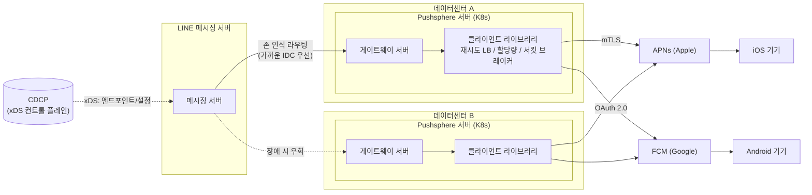
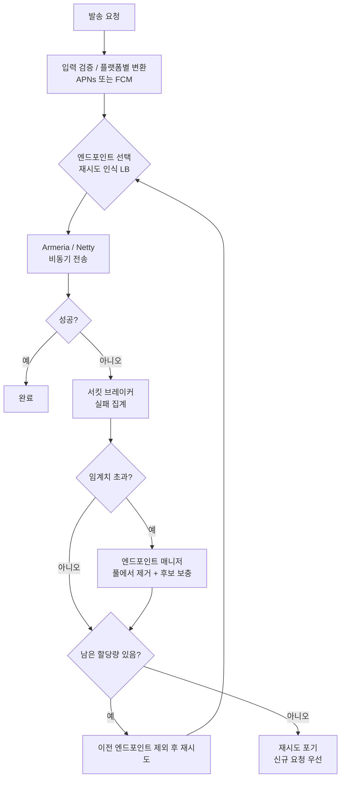

# Pushsphere: 대량 푸시 알림 전송 시스템 정리

- 출처: [Pushsphere: 안정적이고 신속한 대량 푸시 알림 전송](https://techblog.lycorp.co.jp/ko/pushsphere-reliable-and-prompt-high-volume-push-notification)
  (LY Corporation 기술 블로그, Developer eXperience 팀)
- Tech-Verse 2025 발표, 오픈소스: [github.com/line/pushsphere](https://github.com/line/pushsphere)

## 1. 개요

LINE 메신저용 **푸시 알림 게이트웨이 서버 Pushsphere**와
클라이언트 라이브러리를 소개하는 글이다.

## 2. 문제 배경

### 메신저 푸시가 중요한 이유

- 중요한 연락, 지진/화산 같은 재해 경보를 전달한다.
- 누락은 사용자 신뢰와 안전에 직접 영향을 준다.
- 요구 조건: **안정성, 속도, 급변하는 발송량 대응**
- 발송량이 가장 많은 상황은 새해 자정이 아니라 **지진 발생 시**다.
  평소의 수배~수십 배로 급증한다.

### APNs와 FCM이란

모바일 기기로 푸시를 보내려면 OS 제조사가 운영하는 푸시 서비스를
거쳐야 한다. 앱 서버가 기기에 직접 보내는 방식은 지원되지 않는다.

| 항목                   | APNs                            | FCM                      |
| ---------------------- | ------------------------------- | ------------------------ |
| 정식 명칭              | Apple Push Notification service | Firebase Cloud Messaging |
| 운영                   | Apple                           | Google                   |
| 대상                   | iOS, iPadOS, macOS 등           | Android (iOS, 웹도 지원) |
| 인증 (Pushsphere 기준) | mTLS (인증서)                   | OAuth 2.0                |
| 주소 지정              | 기기 토큰                       | 등록 토큰                |
| 특이점                 | DNS 응답마다 IP가 달라짐        | 앱(프로젝트)별 분당 할당량 |

전달 흐름:

```text
앱 서버 --(요청 + 기기 토큰)--> APNs / FCM --(기기와 상시 연결)--> 기기
```

- 기기 OS는 APNs 또는 FCM 서버와 연결을 유지하고 있다.
  앱이 꺼져 있어도 이 연결로 알림이 도착한다.
- 앱 서버는 기기 토큰과 알림 내용을 APNs/FCM에 보내고,
  이후 기기까지의 전달은 APNs/FCM이 맡는다.
- iOS는 APNs만 사용할 수 있고, Android는 보통 FCM을 사용한다.
  그래서 Pushsphere는 두 곳을 모두 지원하는 통합 인터페이스를 둔다.
- 두 서비스 모두 외부 서비스라 장애, 지연, 할당량을 우리가 제어할 수
  없다. 이것이 아래 한계와 Pushsphere의 안정화 기법으로 이어진다.

### 외부 의존성(APNs, FCM)의 한계

- 대체로 안정적이나 일부 인스턴스의 지연, 타임아웃, 연결 끊김이 잦다.
- 재시도 설계가 어렵다: 횟수, 지연, 대상 선택, 문제 인스턴스 재평가 시점.
- **할당량(quota)**: 초과하면 일정 시간 전체 발송이 막힌다.
  무작정 재시도하면 도달률이 오히려 떨어진다. 상향도 쉽지 않다.

#### 케이스별 상세

APNs/FCM은 내부적으로 여러 인스턴스(서버)로 구성된 대규모 클러스터다.
우리는 그 앞의 엔드포인트(IP) 여러 개에 연결해 요청을 보낸다.
(이하 수치는 이해를 돕기 위한 가정이다.)

**케이스 1. 일부 인스턴스만 느리거나 타임아웃**

- 상황: 엔드포인트 8개 중 1개(E3)가 내부 문제로 응답이 느리다.
  나머지 7개는 정상이고, 서비스 전체는 "정상"으로 보인다.
- 문제: 라운드 로빈으로 보내면 요청의 1/8이 E3로 가서 타임아웃이
  난다. 헬스 체크 API가 없어 E3가 문제인지 알 방법이 없다.
- 결과: 전체 장애가 아닌데도 요청의 일부가 계속 실패한다.

**케이스 2. 갑작스러운 연결 끊김**

- 상황: 잘 쓰던 연결(커넥션)이 서버 쪽 사정으로 끊긴다.
  (인스턴스 교체, 배포, 네트워크 문제 등)
- 문제: 그 연결로 전송 중이던 요청이 실패한다. 이미 보냈는지
  못 보냈는지 불확실한 요청도 생긴다.
- 결과: 재연결과 재시도가 필요하고, 끊긴 연결이 몰려 있으면 한꺼번에
  실패한다.

**케이스 3. 재시도가 오히려 실패를 키움**

- 상황: 실패하면 "최대 3회 재시도"로 하드코딩해 두었다.
- 문제 1 (같은 곳 재선택): 재시도가 E3로 다시 갈 수 있다.
  (8개 중 1/8 확률)
- 문제 2 (재시도 폭증): 장애가 나면 원래 요청 1건이 최대 4건
  (원본 1 + 재시도 3)으로 늘어난다.

```text
평소:    요청 100건/분 -> 전송 100건
장애 시: 요청 100건/분 중 50건 실패
         -> 재시도로 50 × 3 = 최대 150건 추가
         -> 실제 전송 시도 최대 250건/분
```

**케이스 4. 할당량 초과 (가장 치명적)**

- 상황: FCM은 앱별로 분당 보낼 수 있는 양이 정해져 있다.
  (예: 분당 N건)
- 진행:
  1. 특정 리전 장애로 실패가 늘어난다.
  2. 케이스 3처럼 재시도가 몰려 시도 건수가 N을 넘는다.
  3. FCM이 할당량 초과로 **429**를 반환한다.
  4. 이 시점부터는 **정상 요청까지** 일정 시간 막힌다.
  5. 막힌 요청도 재시도되어 더 막힌다. (악순환)
- 결과: 일부 인스턴스 문제였던 것이 앱 전체 발송 중단으로 커진다.
  실제로 LINE에서도 정상 요청이 일시적으로 429를 받은 적이 있다.
- 할당량은 외부 정책이라 늘려 달라고 하기도 쉽지 않다.

**케이스 5. 재난 시 트래픽 급증과 겹침**

- 지진 같은 상황에서는 발송량이 평소의 수십 배가 된다.
- 이때 케이스 1~4가 동시에 발생하면 가장 중요한 알림(재해 경보)이
  가장 필요한 순간에 지연되거나 누락될 수 있다.

#### 케이스별 대응 정리

| 케이스                | 원인           | Pushsphere 대응                             |
| --------------------- | -------------- | ------------------------------------------- |
| 1. 일부 인스턴스 지연 | 헬스 체크 없음 | 엔드포인트별 서킷 브레이커, 아웃라이어 감지 |
| 2. 연결 끊김          | 서버 쪽 사정   | 엔드포인트 매니저가 풀 갱신, 재시도         |
| 3. 같은 곳 재선택     | 라운드 로빈    | 재시도 인식 로드 밸런서                     |
| 3. 재시도 폭증        | 횟수 하드코딩  | 할당량 인식 재시도                          |
| 4. 할당량 초과        | 재시도 폭증    | 남은 할당량 확인, 신규 요청 우선            |
| 5. 트래픽 급증        | 재난 상황      | 위 대응 전체 + 존 인식 라우팅               |

자세한 대응 방식은 "4. 클라이언트 내부 구조"를 참고한다.

## 3. 전체 구조

### 구조도



- 점선 화살표: 제어 정보(xDS) 또는 우회 경로
- 실선 화살표: 푸시 데이터 흐름

### 클라이언트 라이브러리 내부 흐름



### 기술 스택

- Kubernetes 배포, Kotlin(JVM)
- 마이크로서비스 프레임워크 **Armeria**, 네트워킹은 **Netty**를 직접 활용

### 두 컴포넌트

| 컴포넌트              | 역할                                   |
| --------------------- | -------------------------------------- |
| 게이트웨이 서버       | LINE 메시징 서버의 발송 요청 수신      |
| 클라이언트 라이브러리 | APNs/FCM으로 전송. 안정화 로직 집약    |

클라이언트 라이브러리는 Armeria의 클라이언트 측 로드 밸런싱과
자동 재시도를 커스터마이징했다.

### 다중 데이터센터

- 2개 데이터센터 운영
- **존 인식 라우팅(zone-aware routing)**: 서버가 자신의 위치와
  상대 가용성을 보고 트래픽을 자율 조정한다. 보통 Envoy 같은 사이드카를
  쓰지만 직접 구현했다.
- **아웃라이어 감지 로드 밸런싱**: 타임아웃 나는 APNs/FCM 인스턴스를
  즉시 걸러낸다.

## 4. 클라이언트 내부 구조

### 4.1 통합 인터페이스

- 단일 진입점으로 iOS/Android 모두 전송
- 입력 검증 후 플랫폼별 형식(FCM, APNs)으로 변환
- `Profile`이 `PushProvider` 정보를 담아 목적지 결정
- 사용: (1) 팩토리 메서드로 푸시 내용 생성 → (2) 기기 토큰과 요청
  객체를 만들어 전송
- 인증: APNs는 mTLS, FCM은 OAuth 2.0
- Armeria → Netty로 비동기 전송. 이후 재시도 모듈, 서킷 브레이커가
  후처리

### 4.2 도달률을 높이는 3가지 기법

#### 1) 재시도 인식 로드 밸런서

- 기본은 라운드 로빈(단순, 공정, 빠름)
- 문제: 재시도 때 직전에 실패한 엔드포인트가 다시 선택될 수 있다.
  (엔드포인트 8개면 1/8 확률)
- 해결: 재시도 컨텍스트를 공유해 **이미 사용한 엔드포인트를 제외**

#### 2) 할당량 인식 자동 재시도

- 배경: Firebase는 앱별 분당 최대 메시지량을 할당한다.
  재시도 횟수가 하드코딩(예: 최대 3회)이어서, 특정 리전 장애 때
  재시도가 몰려 할당량을 넘겼고, 정상 요청이 일시적으로 429를
  받은 적이 있다. 과도한 재시도는 장애를 길게 만들 수도 있다.
- 해결: 재시도 전에 **남은 할당량 확인**. 각 서버가 할당량을
  나눠 갖고 이를 기준으로 재시도 가능량을 계산한다.
  트래픽이 몰리면 재시도보다 **새 요청을 우선**한다.

#### 3) 엔드포인트 매니저 + 서킷 브레이커

- APNs/FCM은 헬스 체크를 제공하지 않아 클라이언트가 상태를 판단한다.
- **엔드포인트별 서킷 브레이커**: 실패가 임계치를 넘으면 매니저에
  통보하고, 해당 엔드포인트를 풀에서 즉시 제거한 뒤 후보 풀에서
  새 엔드포인트로 보충한다.
- APNs는 DNS 응답마다 IP가 달라 주기적으로 DNS를 조회해 후보
  IP 목록을 갱신한다.
- 풀 전체에 브레이커 하나만 두면 일부 장애에도 전체 발송이 멈출 수
  있어 엔드포인트 단위가 더 탄력적이다.

### 4.3 도입 효과

| 항목                   | 기존                         | Pushsphere                   |
| ---------------------- | ---------------------------- | ---------------------------- |
| 온콜 알람              | 연 30건 이상 (느슨한 임계치) | 2025년 4건 (더 엄격한 조건)  |
| 최종 전송 실패율       | -                            | 0에 가까움                   |
| 최근 30일 유의미한 에러 | -                            | 1건                          |

## 5. 서버 인프라 개선

### L4 로드 밸런서란

로드 밸런서(LB)는 들어오는 요청을 여러 서버에 나눠 주는 장비/소프트웨어다.
L4, L7은 OSI 7계층 중 어느 계층의 정보를 보고 분배하느냐의 차이다.

| 항목      | L4 (전송 계층)      | L7 (애플리케이션 계층)                  |
| --------- | ------------------- | --------------------------------------- |
| 보는 정보 | IP, 포트, TCP/UDP   | HTTP 헤더, URL, 쿠키, 본문              |
| 분배 단위 | 연결(커넥션)        | 요청(리퀘스트)                          |
| 처리 비용 | 낮음, 빠름          | 높음, 상대적으로 느림                   |
| 가능한 일 | 연결을 서버에 전달  | 경로별 라우팅, 헤더 기반 분기, 재시도 등 |

동작 예 (L4):

```text
클라이언트 --TCP 연결--> L4 LB --(연결 단위로 서버 선택)--> 서버 A/B/C
```

- L4는 HTTP 내용을 보지 않고 연결 단위로 서버를 고른다.
- HTTP/2처럼 **하나의 연결로 많은 요청을 계속 보내는** 경우, 연결이
  한 서버에 붙으면 그 연결의 요청이 전부 그 서버로 간다.
  연결 수는 균등해도 **요청 수는 불균등**해질 수 있다.
  (아래 "균등 분배 실패" 문제의 배경이다. 원문에 이 원인이
  명시된 것은 아니고 일반적인 동작을 보충한 것이다.)
- LB 한 대(또는 한 쌍)가 모든 트래픽의 길목이 되므로 장애 시
  전체가 멈추는 **SPOF**가 되기 쉽다.

### SPOF란

**SPOF(Single Point of Failure, 단일 장애점)** 는 그 한 곳이 고장 나면
시스템 전체가 멈추는 구성 요소를 말한다.

```text
[SPOF 있음]
클라이언트 -> L4 LB (1대) -> 서버 A, B, C
              ^ 여기가 죽으면 서버 A, B, C가 멀쩡해도 전체 중단

[SPOF 없음]
클라이언트 -> 서버 A, B, C 중 살아있는 곳을 직접 선택
              (한 곳이 죽어도 나머지로 계속 처리)
```

- 서버 A, B, C를 여러 대로 늘려도 앞단의 LB가 하나면 안정성은
  LB 한 대 수준으로 제한된다.
- 일반적인 해결: 해당 요소를 이중화(여러 대 구성)하거나, 아예 없앤다.
- Pushsphere는 중앙 LB를 없애고 클라이언트 측 로드 밸런싱을
  사용해 이 지점을 제거했다. (아래 "해결" 참고)
- 푸시 알림에서는 재해 경보처럼 가장 중요한 순간에 전체 발송이
  멈출 수 있어 특히 치명적이다.

### 초기 구조의 문제

- 단일 K8s 클러스터 앞 **L4 로드 밸런서 하나**가 모든 푸시 트래픽 수신
- 균등 분배 실패 → 특정 서버 과부하
- L4가 **SPOF**
- L7은 요구 사항 **40만 QPS**를 감당하지 못함
- 고립된 K8s 네트워크라 클라이언트 측 LB 불가, 멀티 리전 미지원

### 해결: CDCP 기반 xDS 서비스 메시

- 사내 **CDCP(Central Dogma Control Plane)** 를 xDS 서비스 메시로 사용
- K8s에서도 클라이언트 측 LB → 중앙 LB 제거
- 엔드포인트 추가/설정 변경이 실시간 반영
- 멀티 IDC + 존 인식 라우팅으로 가까운 IDC로 전송
- LINE 메시징 서버가 xDS로 엔드포인트 정보를 받아
  **proxyless service mesh**를 구성하고 K8s 노드 포트로 직접 전송

```text
[이전]
LINE 메시징 서버 -> L4 LB (SPOF) -> K8s 클러스터 -> Pushsphere

[이후]
CDCP --xDS--> LINE 메시징 서버 --(직접, 존 인식)--> Pushsphere(노드 포트)
```

## 6. 핵심 교훈

- 안정적인 푸시 전송에는 존 인식 라우팅과, 앱 수준 힌트(재시도 상태,
  서킷 브레이커 상태, 할당량)를 반영한 로드 밸런싱이 필요하다.
- 대규모 트래픽에서는 기본 K8s 구성만으로 한계가 있어 클라이언트 측
  로드 밸런싱과 사이드카 없는 서비스 메시가 필요하다.

## 7. 향후 계획

- Java API 사용성 개선 (Kotlin 기반이라 불편한 부분)
- iOS Live Activities 지원
- 액세스 토큰/인증서를 더 안전한 저장소에 보관
- 진정한 오픈소스화 (현재는 소스만 공개)
- 로드 밸런서 일반화 및 Armeria로 기능 통합
- 관리 콘솔 검토 (필요성 불확실)
