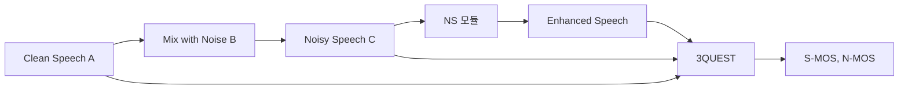

# LINE 앱의 잡음 제거(NS) 성능 측정 방법

2026년 10월 1일 오전 7:49

## 1. 배경: 왜 NS 성능을 "측정"해야 하나

마이크에는 사용자 목소리와 주변 소음이 섞여 들어온다.
NS(Noise Suppression)는 이 중 소음만 줄여 상대방에게 깨끗한 음성을 전달하는 기술이다.

NS 튜닝에는 서로 충돌하는 두 목표가 있다.

| 목표 | 너무 지나치면 |
| --- | --- |
| 잡음을 많이 제거 | 목소리까지 깎여 소리가 끊기고 로봇처럼 들림 |
| 음성을 그대로 보존 | 잡음이 그대로 남아 NS 효과가 없음 |

[예시] 카페에서 통화할 때 NS가 너무 세면 말끝이 잘려 들리고, 너무 약하면 주변 대화 소리가 상대에게 그대로 들린다.

그래서 "잡음이 얼마나 줄었나"와 "음성이 얼마나 안 망가졌나"를
**각각 숫자로** 재야 개선 방향을 잡을 수 있다.

## 2. 전체 절차

1. 성능 측정 접근 방식 수립
2. 데이터셋 선정
3. 테스트 데이터셋 준비
4. 평가 지표 선정
5. 측정 시스템 환경 구성
6. NS 성능 측정

## 3. 데이터셋

### 3.1 Group A: 음성 데이터

| 항목 | 내용 |
| --- | --- |
| 출처 | AI Hub 다국어 통·번역 낭독체 데이터 |
| 사용 경로 | Validation - 원천 데이터 - VSLenL11 |
| 개수 | 17,981개 |
| 샘플링 | 48kHz |

- 자료: [AI Hub 다국어 통·번역 낭독체 데이터](https://aihub.or.kr/aihubdata/data/view.do?currMenu=115&topMenu=100&aihubDataSe=data&dataSetSn=71524)
- 48kHz를 고른 이유: 사람의 가청 범위(약 20Hz~20kHz)를 충분히 담아, NS가 주파수 대역별로 어떻게 동작하는지 정밀하게 볼 수 있다.

[예시] 샘플링 레이트(fs)로 표현 가능한 최대 주파수는 fs/2(나이퀴스트)다. 48kHz면 24kHz까지 표현되어 가청 범위를 덮는다. 8kHz 샘플이면 4kHz까지라 고음 대역 NS 동작을 볼 수 없다.

### 3.2 Group B: 잡음 데이터 (DEMAND)

- 자료: [DEMAND (zenodo)](https://zenodo.org/records/1227121)
- 18개 장면, 장면당 16채널, 장면당 5분, 48kHz
- 16채널 = 같은 장면을 서로 다른 위치 16곳에서 동시에 녹음
  - [예시] 같은 카페라도 마이크가 창가인지 주방 옆인지에 따라 다른 잡음 파일이 된다. 즉 18 × 16 = 288개의 잡음 소스가 있다.

| 대분류 | 장면 | 설명 |
| --- | --- | --- |
| 주거 | Washing | 세탁기 작동 중인 세탁실 |
| 주거 | Kitchen | 음식 준비 중인 주방 |
| 주거 | Living | 노래가 재생되는 거실 |
| 자연 | Field | 스포츠 경기장 |
| 자연 | River | 물이 흐르는 시냇가 |
| 자연 | Park | 관광객이 많은 공원 |
| 사무 | Office | 3명이 컴퓨터를 쓰는 사무실 |
| 사무 | Hallway | 사람이 지나가는 복도 |
| 사무 | Meeting | 논의 중인 회의실 |
| 공공 | Station | 지하철 환승 구역 |
| 공공 | Cafeteria | 번잡한 사무실 카페테리아 |
| 공공 | Restaurant | 점심시간 대학 식당 |
| 거리 | Traffic | 번잡한 교차로 |
| 거리 | PSquare | 관광객이 많은 광장 |
| 거리 | Cafe | 광장의 카페테리아 |
| 교통 | Metro | 지하철 |
| 교통 | Bus | 버스 |
| 교통 | Car | 승용차 |

잡음 성격이 다양하다.

- 정상(stationary) 잡음: 세탁기, 자동차 엔진, 에어컨 (일정한 소리)
- 비정상(non-stationary) 잡음: 식당 대화, 복도 발소리, 교차로 경적 (시간에 따라 변함, 특히 NS가 어려워함)

## 4. 테스트 데이터셋 만들기

### 4.1 세 가지 데이터셋

| 데이터셋 | 내용 | 역할 |
| --- | --- | --- |
| A | 깨끗한 음성 3,780개 (Group A에서 무작위, 중복 없음) | 정답(레퍼런스) |
| B | 잡음 3,780개 (16채널 × 18장면 중 무작위) | 혼합용 잡음 |
| C | A + B 혼합 | NS 입력 (실사용 모사) |

### 4.2 왜 레벨과 SNR을 나누나

실제 통화에서 입력 조건은 다음 세 가지에 따라 크게 달라진다.

| 변수 | 영향 |
| --- | --- |
| 화자-마이크 거리 | 멀수록 음성이 작게 녹음됨 |
| 화자 목소리 크기 | 크게 말할수록 레벨 증가 |
| 잡음원 위치/세기 | SNR을 좌우 (가깝고 클수록 SNR 낮음) |

이를 **레벨(전체 볼륨)** 과 **SNR(음성 대 잡음 비)** 두 축으로 단순화한다.

### 4.3 SNR이란

SNR(Signal-to-Noise Ratio)은 음성 세기와 잡음 세기의 비를 dB로 나타낸 값이다.

```
SNR(dB) = 10 × log10(음성 전력 / 잡음 전력)
        = 음성 레벨(dB) - 잡음 레벨(dB)
```

| SNR | 해석 | 상황 예시 |
| --- | --- | --- |
| -5 dB | 잡음이 음성보다 큼 | 공사장 옆, 매우 시끄러운 카페 |
| 0 dB | 음성 = 잡음 | 매우 시끄러운 환경 |
| 5 dB | 음성이 약간 큼 | 시끄러운 환경 |
| 10 dB | 음성 우위 | 일반적으로 시끄러운 환경 |
| 15 dB | 음성이 상당히 큼 | 일반적인 환경 |
| 20 dB | 음성이 훨씬 큼 | 비교적 조용한 사무실 |

[예시]

- SNR 0dB: 음성과 잡음의 세기가 같다. 말이 잘 안 들린다.
- SNR 10dB: 음성 전력이 잡음의 10배.
- SNR 20dB: 음성 전력이 잡음의 100배.
- SNR -5dB: 잡음이 음성보다 약 3.2배 크다.

### 4.4 레벨이란

혼합 신호 전체의 볼륨이다. 단위는 dBFS(디지털 최대치 기준)라 음수로 표시된다.
0에 가까울수록 크고, 작을수록 조용하다.

| 레벨 | 해석 |
| --- | --- |
| -15 dB | 큰 소리 (큰 목소리, 마이크에 가까움) |
| -20 dB | 중간~큰 소리 |
| -25 dB | 중간 소리 |
| -30 dB | 중간~작은 소리 |
| -35 dB | 작은 소리 |
| -40 dB | 매우 작은 소리 |
| -45 dB | 가장 작은 소리 |

레벨을 나누는 이유: NS와 함께 동작하는 게인 제어 등은 입력이 작을 때 음성을 잡음으로 오판해 지우는 경향이 있을 수 있다.
따라서 작은 소리에서의 성능도 따로 확인해야 한다.

### 4.5 혼합 예시

[예시] 조건 "장면=Cafe, SNR=5dB, 레벨=-30dB"인 파일 만들기

1. Group A에서 음성 파일 1개 선택 (예: 영어 낭독 문장)
2. Group B의 Cafe 장면 채널 중 하나에서 같은 길이만큼 잘라냄
3. 음성 대비 잡음이 5dB 작도록 잡음 크기를 조정해 더함
4. 합쳐진 신호의 전체 레벨이 -30dB가 되도록 볼륨 조정
5. 이 파일이 테스트 데이터셋 C의 1개 원소가 된다.

### 4.6 규모 계산

- 조건 수: 7(레벨) × 6(SNR) = 42
- 조건당 5개 → 장면당 42 × 5 = 210개
- 전체: 18(장면) × 210 = 3,780개

레벨/SNR 분포 (각 칸 = 장면마다 5개):

| 레벨 \ SNR | -5 | 0 | 5 | 10 | 15 | 20 |
| --- | --- | --- | --- | --- | --- | --- |
| -15 dB | 5 | 5 | 5 | 5 | 5 | 5 |
| -20 dB | 5 | 5 | 5 | 5 | 5 | 5 |
| -25 dB | 5 | 5 | 5 | 5 | 5 | 5 |
| -30 dB | 5 | 5 | 5 | 5 | 5 | 5 |
| -35 dB | 5 | 5 | 5 | 5 | 5 | 5 |
| -40 dB | 5 | 5 | 5 | 5 | 5 | 5 |
| -45 dB | 5 | 5 | 5 | 5 | 5 | 5 |

조건당 5개를 쓰는 이유: 1개만 쓰면 문장/화자에 따른 우연이 크지만, 5개 평균을 내면 조건별 대표성이 확보된다.

## 5. 평가 지표

### 5.1 왜 3QUEST인가

| 방식 | 특징 | 한계 |
| --- | --- | --- |
| ITU-T P.835 | 사람이 듣고 점수를 매기는 주관 평가 | 비용/시간이 크고 평가자마다 결과가 다름 |
| 3QUEST | P.835 기반, HEAD acoustics가 개발한 소프트웨어 평가 (객관적, 동일 입력 = 동일 결과) | - |

- 3QUEST는 ETSI EG 202 396-3으로 표준화되어 있다.
- 자료: [3QUEST Application Note (HEAD acoustics)](https://global.head-acoustics.com/downloads/eng/application_notes/telecom/Appl_note_3QUEST_e0.pdf)
- [예시] 3,780개 파일을 사람이 듣고 평가하면 수 주가 걸릴 수 있다.
  소프트웨어는 NS 코드를 고칠 때마다 전체를 자동으로 재측정한다.

### 5.2 3QUEST가 내놓는 지표 (모두 1~5, 높을수록 좋음)

**S-MOS (Speech MOS)**: NS 후 "음성"이 얼마나 안 망가졌나

| 점수 | 평가 |
| --- | --- |
| 5 | NOT DISTORTED (왜곡 없음) |
| 4 | SLIGHTLY DISTORTED |
| 3 | SOMEWHAT DISTORTED |
| 2 | FAIRLY DISTORTED |
| 1 | VERY DISTORTED |

**N-MOS (Noise MOS)**: NS 후 "잡음"이 얼마나 안 들리나

| 점수 | 평가 |
| --- | --- |
| 5 | NOT NOTICEABLE (감지 불가) |
| 4 | SLIGHTLY NOTICEABLE |
| 3 | NOTICEABLE BUT NOT INTRUSIVE |
| 2 | SOMEWHAT INTRUSIVE |
| 1 | VERY INTRUSIVE |

**G-MOS (Global MOS)**: S와 N을 합친 전체 통화 품질
(5 EXCELLENT / 4 GOOD / 3 FAIR / 2 POOR / 1 BAD)

### 5.3 LINE은 S-MOS와 N-MOS만 쓴다

G-MOS는 전체 품질 하나만 주므로, 점수가 떨어졌을 때 음성 왜곡 탓인지 잔여 잡음 탓인지 알 수 없다. 둘을 따로 보면 원인이 바로 구분된다.

[예시] 해석 사례 (수치는 가상)

| 상황 | S-MOS | N-MOS | 해석 |
| --- | --- | --- | --- |
| NS 끔 | 4.5 | 1.5 | 음성은 원본이나 잡음이 그대로 |
| NS 약하게 | 4.3 | 2.8 | 잡음 일부 제거, 음성 거의 보존 |
| NS 강하게 | 2.5 | 4.6 | 잡음은 사라졌으나 음성이 심하게 왜곡 |
| 개선 목표 | 4.2 | 4.0 | 둘 다 높은 균형점 |

## 6. 측정 시스템과 실행 흐름



3QUEST에는 세 파일이 들어간다.

| 입력 | 파일 | 용도 |
| --- | --- | --- |
| 참조 | A (Clean Speech) | 원래 음성이 무엇인지 기준 |
| 잡음 섞인 입력 | C (Noisy Speech) | NS 전 상태 |
| 출력 | Enhanced Speech | NS 후 상태 |

실행 순서:

1. C 3,780개를 NS 모듈에 넣어 Enhanced 3,780개를 얻는다.
2. 각 파일 세트(A, C, Enhanced)를 3QUEST에 넣는다.
3. 파일마다 S-MOS, N-MOS가 자동 산출된다.
4. 장면/SNR/레벨별로 점수를 집계해 분포를 본다.

## 7. 결과 해석 방법

[예시] 집계 관점별로 볼 수 있는 것

| 집계 축 | 확인할 수 있는 것 | 예 |
| --- | --- | --- |
| 장면별 | 특정 잡음에 약한지 | Restaurant(대화 잡음)에서 N-MOS만 낮음 |
| SNR별 | 저 SNR에서의 한계 | -5dB에서 S-MOS가 급락 |
| 레벨별 | 작은 소리 대응 | -45dB에서 음성이 지워져 S-MOS 하락 |
| 전체 평균 | 버전 간 총합 비교 | v1 대비 v2의 N-MOS +0.3 |

개선 사이클: 측정 → 약한 조건 식별 → NS 수정 → 같은 데이터로 재측정 → 전/후 비교.
