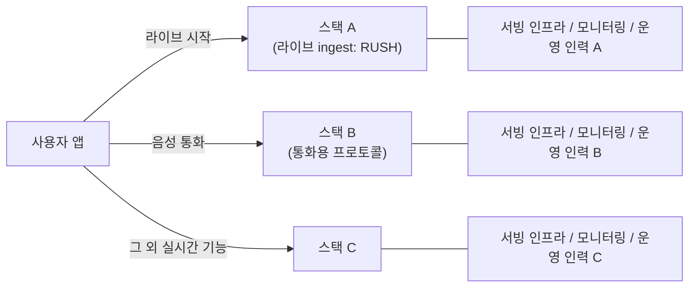
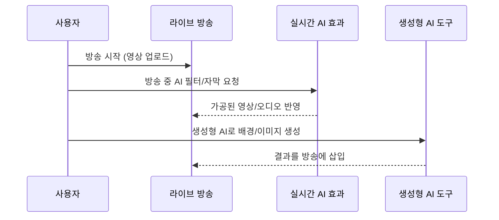
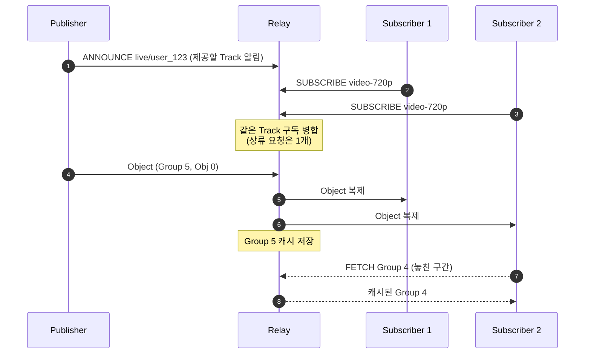
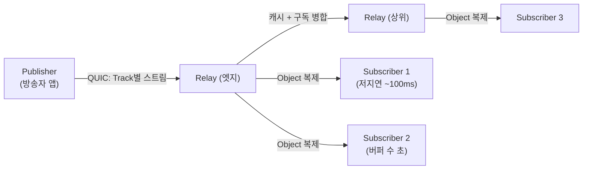
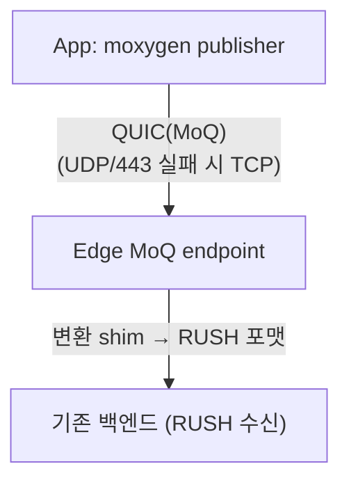

# Instagram Live 인제스트에 MoQ 적용 (Meta) 정리

2026년 10월 15일 오후 2:22

출처: [Shipping Media over QUIC at Meta scale for Instagram Live ingest](https://engineering.fb.com/2026/10/12/video-engineering/shipping-media-over-quic-at-meta-scale-for-instagram-live-ingest/) (Meta, 2026-10-12)

## 1. 요약

- Instagram Live 업로드(ingest)를 자체 프로토콜 RUSH에서
  IETF 표준 MoQ(Media over QUIC)로 전환했다 (iOS/Android).
- 결과: RUSH와 스트리밍 품질·안정성 지표가 동등 (수치는 비공개).
- 백엔드는 그대로 두고, 엣지에서 MoQ를 RUSH로 변환하는 방식으로 배포했다.

## 2. 배경: 왜 바꿨나

| 항목 | 내용 |
| --- | --- |
| 프로토콜 파편화 | 라이브 → 통화 등 한 흐름에서 3개 스택을 거침 |
| 유스케이스 수렴 | 라이브, 실시간 AI, 생성형 AI 도구가 같은 화면을 공유 |
| RUSH의 한계 | 약 10년 된 Meta 단독 운영 프로토콜 → 표준 협업으로 이동 |

### 예시

**1) 프로토콜 파편화: 한 사용자 흐름이 3개 스택을 거침**



- 스택마다 서버, 모니터링, 장애 대응 노하우를 따로 유지해야 한다.
- 기능 하나를 개선해도 3곳에 각각 반영해야 한다.
- MoQ로 통합하면 이 중복 비용을 줄일 수 있다는 것이 Meta의 기대이다.

**2) 유스케이스 수렴: 한 화면에서 여러 실시간 기능이 섞임**



- 이런 기능들이 같은 화면에서 동시에 쓰이면, 각각 다른 전송 방식을
  쓸 때 연결·인증·재연결 로직이 기능마다 따로 필요해진다.
- 하나의 전송 모델(Track 구독)로 통일하면 기능을 조합하기 쉬워진다.

**3) RUSH의 한계: 단독 운영 vs 표준 협업**

| 항목 | RUSH (자체 프로토콜) | MoQ (표준) |
| --- | --- | --- |
| 스펙 개선 | Meta 내부만 | Google, Akamai, Cisco, Cloudflare, 학계와 협업 |
| 구현체 | Meta 구현만 | 여러 구현체 (상호운용 검증) |
| 새 기능(예: 재생 확장) | 직접 설계·유지 | 표준 진화를 활용 |
| 유지 부담 | 전부 Meta | 분담 |

## 3. MoQ 상세

### 3.1 기존 프로토콜의 한계

| 프로토콜 | 전송 | 한계 |
| --- | --- | --- |
| RTMP | TCP | 패킷 하나 손실 시 뒤 데이터 전부 대기(HOL blocking). 오디오/비디오가 한 바이트 스트림에 섞임. 중계/캐시 개념 없음 |
| HLS/DASH | HTTP | CDN 확장은 쉬우나 세그먼트(수 초) 단위라 지연이 큼 |
| WebRTC | UDP(RTP) | 지연은 낮으나 SFU 같은 상태 유지 서버가 필요해 대규모 팬아웃이 어렵고, 시그널링(SDP)·ICE 등 구성이 복잡 |

→ 낮은 지연, 대규모 팬아웃, 단순한 구조를 한 프로토콜로 얻기 어려웠다.
MoQ는 이 셋을 목표로 한 pub/sub 프로토콜이다.

### 3.2 데이터 모델

```text
Namespace (예: live/user_123)
└─ Track (예: video-720p, audio)
   └─ Group (독립 디코딩 단위, 예: GOP)
      └─ Object (프레임/청크, 전달의 최소 단위)
```

- **Object**: 순서 번호가 있는 데이터 조각. 헤더에 우선순위 등 메타데이터.
- **Group**: 이 Group만 받아도 디코딩이 시작되는 단위.
  (비디오는 I-frame으로 시작하는 GOP)
- **Track**: Group의 시퀀스. 구독의 단위.
- **Relay**: 페이로드는 암호화/불투명 상태로 두고, 헤더(Track, Group,
  우선순위)만 보고 캐시·전달·폐기한다.

구조는 클라이언트 → Relay → 클라이언트이며 P2P가 아니다.
Relay는 SFU와 역할이 비슷하나, 세션 상태 대신 Track 구독 단위로
동작하고 캐시가 내장되어 있어 CDN처럼 계층 구성이 쉽다.

#### Group 상세

Group은 패킷이 아니라 **독립적으로 재생을 시작할 수 있는 구간**이라는
미디어 논리 단위이다 (IETF MoQ draft 기준 일반 지식).

```text
Track
└─ Group 0, Group 1, Group 2 ...  (논리 단위, 디코딩 경계)
   └─ Object 0, Object 1, ...     (프레임/청크)
      └─ QUIC 패킷 여러 개         (네트워크 전송 단위)
```

비디오 예시 (Object 하나가 프레임 하나):

```text
Group 5: [I-frame] [P] [P] [P] ... [P]
Group 6: [I-frame] [P] [P] [P] ... [P]
```

- Group 안의 P-frame은 앞 프레임에 의존하므로 순서가 중요하다.
- Group끼리는 서로 의존하지 않는다.
- 오디오는 보통 일정 시간 분량을 하나의 Group으로 묶는다.

Group이 필요한 이유:

- 손실/지연 시 Group 단위로 버리거나 건너뛸 수 있다.
  (Group 5 폐기 → Group 6의 새 I-frame부터 전송, 화면 깨짐 없음)
- 늦게 들어온 시청자는 최신 Group 시작부터 받아 바로 재생한다.
- Relay는 Group 단위로 캐시하고 폐기한다.
- 한 Group(또는 Subgroup)이 QUIC 스트림 하나에 대응하므로,
  폐기는 해당 스트림 reset으로 처리한다.

### 3.3 동작 방식 (pub/sub)



- 핵심은 **Group/Subgroup 하나를 QUIC 스트림 하나에 매핑**하는 것이다.
  스트림끼리 독립이므로 한 스트림의 손실이 다른 스트림을 막지 않는다.
- 각 Object에 **우선순위**와 **전달 타임아웃**을 줄 수 있다.
  네트워크가 막히면 오래된 Group의 스트림을 reset(폐기)하고
  최신 Group을 먼저 보낸다.

### 3.4 구조도



### 3.5 손실 상황 비교 (예시)

상황: 업로드 중 1초간 네트워크가 나빠져 패킷이 손실됨.

```text
RTMP(TCP)
  손실 패킷 재전송 완료까지 뒤 프레임 전체 정체
  → 정체된 만큼 지연이 쌓이고, 회복 후에도 그 지연이 남음

MoQ
  Group 5 스트림에서 손실 → 그 스트림만 재전송/지연
  지연 한도 초과 시 Group 5 폐기, Group 6(최신 I-frame)부터 전송
  오디오 Track은 우선순위가 높아 먼저 전달
  → 화면은 잠깐 건너뛰지만 지연이 누적되지 않고 소리는 유지
```

### 3.6 이점 정리

| 이점 | 이유(메커니즘) | 효과 |
| --- | --- | --- |
| 지연 누적 방지 | 스트림 독립 + 오래된 Group 폐기 | 손실 후에도 실시간성 유지 |
| 오디오 보호 | Track별 우선순위 | 영상이 끊겨도 소리는 유지 |
| 확장성 | Relay가 Track 단위로 구독 병합·캐시·복제, 계층 연결 | SFU보다 단순한 구조로 대규모 팬아웃 (P2P 아님, 서버 경유) |
| 지연 선택 | 구독자별 타임아웃 설정 | 같은 Track으로 저지연/버퍼 시청 모두 지원 |
| 연결 안정성 | QUIC 연결 마이그레이션 | Wi-Fi ↔ LTE 전환 시 세션 유지 |
| 빠른 시작 | QUIC 1-RTT/0-RTT 핸드셰이크 | 연결 수립 시간 단축 |
| 스택 통합 | ingest/재생/실시간 모두 같은 모델 | 프로토콜·운영 도구 수 감소 (Meta의 동기) |
| 표준 | IETF, 다수 구현체 | 특정 벤더 종속 감소 |
| 방화벽 대응 | WebTransport(H2)/QMUX 폴백 | UDP 차단망에서도 연결 |

### 3.7 한계와 주의

- 아직 draft 단계라 스펙이 바뀐다 (Meta도 draft 버전 고정으로 대응).
- UDP/443 차단망에서는 폴백 경로가 필요하다.
- 암호화된 QUIC은 패킷 캡처 디버깅이 어렵다 (MoQ 인지 트레이싱 필요).
- Meta는 이번에 RUSH와 **동등한 품질**을 달성했다고만 밝혔다.
  즉 이번 전환의 직접 이점은 성능 향상보다 **표준화와 스택 통합**이다.

### 3.8 WebRTC(SFU)와 비교

| 항목 | WebRTC + SFU | MoQ |
| --- | --- | --- |
| 전송 | RTP/SRTP over UDP (ICE, DTLS) | QUIC (스트림, 데이터그램) |
| 시그널링 | 표준 밖. 서비스마다 SDP 교환 구현 | 프로토콜 안에 포함 (ANNOUNCE, SUBSCRIBE) |
| 데이터 단위 | RTP 패킷 (세션/참가자 중심) | Track / Group / Object (구독 중심) |
| 손실 처리 | 비신뢰 UDP + NACK/FEC | 스트림 재전송 또는 오래된 Group 폐기 |
| 우선순위 | 제한적 | Track/Object별로 프로토콜에 포함 |
| 캐시/과거 조회 | 보통 없음 | Group 캐시, FETCH |
| 중계 계층화 | 캐스케이드 가능하나 비표준 | Relay 계층 구성이 기본 모델 |
| 미디어 종속 | RTP 패킷화, 코덱 협상 | 페이로드 불투명 (미디어 비종속) |
| 성숙도 | 브라우저 지원 완성 | IETF draft 단계 |

### 3.9 그냥 WebRTC를 쓰면 안 되나

**WebRTC가 더 나은 경우**

- 양방향 통화·회의처럼 수백 ms 이하 지연이 필수인 경우
- 브라우저에서 바로 동작해야 하는 경우
- 에코 제거, 지터 버퍼, 혼잡 제어 등 검증된 기능을 그대로 쓰는 경우
- 스펙이 안정적이어야 하는 경우

**MoQ를 고려하는 경우**

- 한 방송을 매우 많은 시청자에게 전달 (1:N, CDN형 확장)
- 같은 Track을 시청자별 다른 지연으로 제공 (저지연 + 버퍼)
- 하나의 프로토콜로 ingest·재생·실시간을 통합하고 싶은 경우
- 시그널링/서버 구현을 서비스마다 따로 만드는 비용을 줄이고 싶은 경우
- 벤더 중립 표준(IETF) 위에 구축하고 싶은 경우

**Meta의 경우**

- 성능 개선이 목적이 아니다 (RUSH와 동등한 품질을 확인했을 뿐).
- 목적은 자체 프로토콜(RUSH) 유지 부담 제거와 스택 통합이다.
- WebRTC로 가지 않은 이유는 원문에 명시되지 않았다.
  다만 ingest는 단방향 1:N이고 이미 QUIC 기반 RUSH가 있었으므로
  같은 QUIC 계열인 MoQ가 이전 경로로 자연스러웠을 것으로 추정된다
  (추정이며 원문 근거 없음).

**결론**

- 새로 서비스를 만든다면 지금은 WebRTC가 안전한 선택인 경우가 많다.
- MoQ는 대규모 1:N 라이브와 스택 통합이 필요한 곳에서 의미가 있고,
  아직 성숙 중인 표준이다.

## 4. 왜 Instagram Live가 먼저인가

1. 가장 큰 규모의 ingest 부하 → 스케일 검증에 적합
2. RUSH → 표준 이동으로 구현체 간 상호운용성 향상
3. RUSH와 지표를 맞춰 두면 이후 재생(playback) 확장의 기준선이 됨

## 5. 롤아웃 아키텍처



1. **클라이언트**: moxygen(Meta 오픈소스 MoQ 라이브러리) + mvfst(QUIC).
   방송 단위로 설정 파라미터 하나로 MoQ/RUSH 선택.
2. **엣지 변환**: 백엔드 재작성 없이 wire format만 교체.
   MoQ가 유일 경로가 되면 백엔드가 MoQ를 직접 수신하고 shim 제거.
3. **서버 측 라우팅**: 스트림 URL 생성 시 실험군이면 MoQ 엔드포인트 발급.
   앱 버전 배포와 무관, 실험 비율을 수 분 내 조정 가능.

## 6. 운영상 난관

| 문제 | 대응 |
| --- | --- |
| 스펙 draft 변경 | draft 버전 고정, 구버전 호환 shim, IETF에 수정 환원 |
| UDP/443 차단 | 세션 시작 시 TCP/QUIC 핸드셰이크 중 먼저 성공한 쪽 선택, 세션 내 유지 |
| 암호화로 디버깅 어려움 | 엣지에 MoQ 인지 트레이싱 (복호화 없이 Object 단위 이벤트) |

## 7. 향후 계획

- Subgroup으로 오디오/비디오/메타데이터를 독립 스트림화 (손실 내성)
- QMUX로 TCP 폴백 표준화 → RUSH 은퇴 가능
- 전달·재생까지 확장 (생성 즉시 push, 부분 신뢰성, ABR)
- 양방향 저지연 실시간 AI

## 8. 예시

### 8.1 Track / Object 모델

```text
Namespace: live/user_123/broadcast_456
├─ Track "video-720p"
│  ├─ Group 0: [Obj0(I) Obj1(P) Obj2(P) ...]
│  └─ Group 1: [Obj0(I) Obj1(P) ...]
├─ Track "video-360p"  (같은 구조, 낮은 비트레이트)
├─ Track "audio"
└─ Track "metadata"
```

- Group = 독립 디코딩 단위(예: GOP). 손실 시 오래된 Group을 건너뛴다.
- 구독자/Relay가 Track별 우선순위를 줄 수 있다 (오디오 > 비디오).

### 8.2 클라이언트 전송 선택 (QUIC vs TCP 레이스) - 의사코드

```python
async def connect(endpoint):
    quic = asyncio.create_task(moq_over_quic(endpoint))               # UDP/443
    tcp = asyncio.create_task(moq_over_webtransport_h2(endpoint))
    done, pending = await asyncio.wait(
        {quic, tcp}, return_when=asyncio.FIRST_COMPLETED)
    for t in pending:
        t.cancel()
    return done.pop().result()  # 세션 동안 이 전송 유지
```

### 8.3 방송 단위 프로토콜 선택 - 의사 설정

```json
{
  "broadcast_id": "456",
  "ingest_protocol": "moq",
  "endpoint": "moq-edge.example.com:443",
  "fallback": "rush"
}
```

서버가 실험군 여부로 `ingest_protocol`과 `endpoint`를 결정해
스트림 URL과 함께 내려준다 (앱 업데이트 불필요).

### 8.4 엣지 변환 shim - 의사코드

```python
def on_moq_object(obj):
    # MoQ Object → RUSH 프레임
    frame = RushFrame(
        stream=map_track(obj.track),  # audio/video 구분
        pts=obj.timestamp,
        payload=obj.payload,          # 미디어는 그대로 전달
    )
    backend.send(frame)
```

### 8.5 구독별 지연 차이

| 구독자 | 목표 지연 | 동작 |
| --- | --- | --- |
| 인터랙티브 시청 | ~100 ms | 지연 초과 Object drop, 최신 Group으로 점프 |
| 아카이브/버퍼 시청 | 수 초 | 버퍼 후 재생, 손실 시 재전송 대기 |

## 9. 원문에 없는 부분

- 혼잡 제어 알고리즘 상세
- 지연·스톨·비트레이트 등 구체 수치
- 실제 코드/설정 (위 8장은 예시일 뿐)
