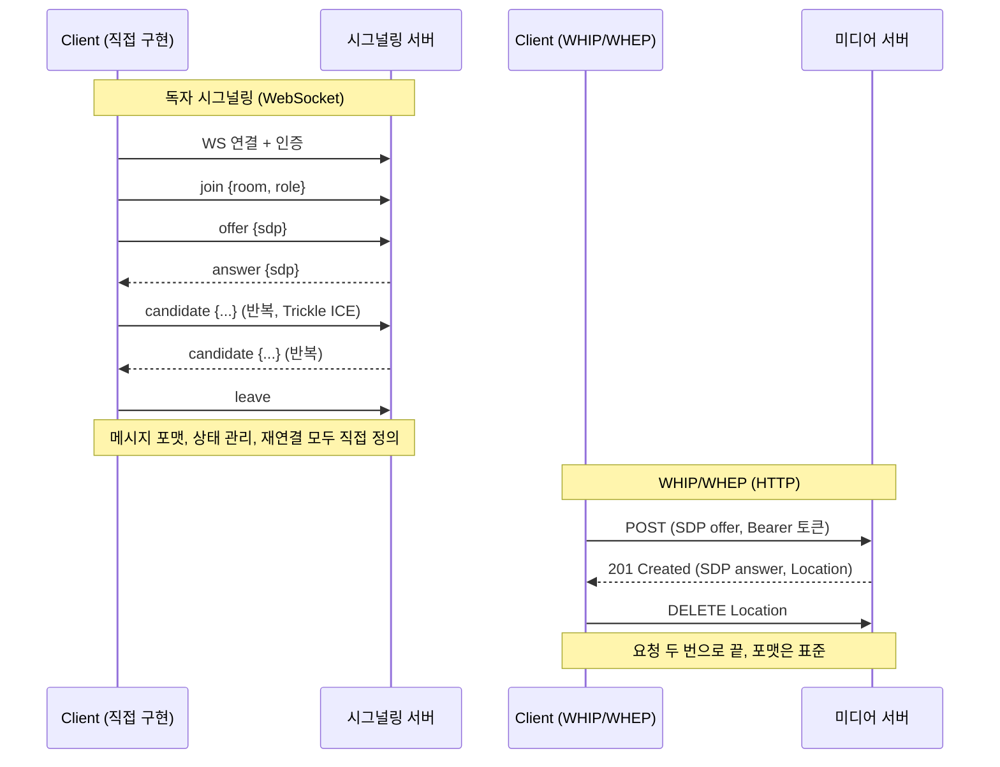
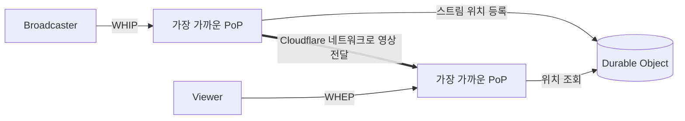
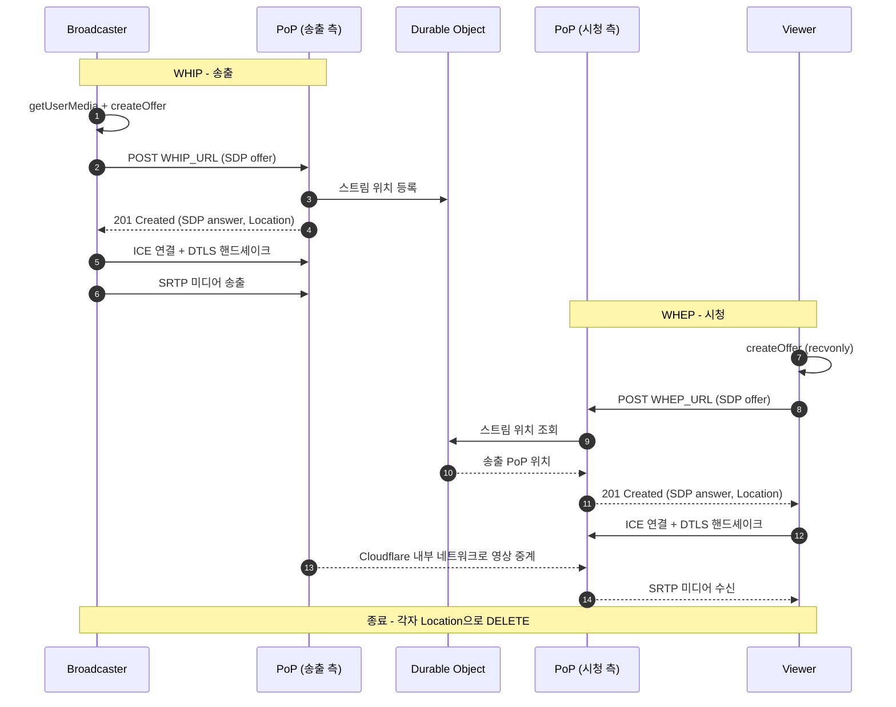

# Cloudflare Stream의 WHIP/WHEP 기반 WebRTC 라이브 스트리밍 정리

2026년 10월 19일 오전 7:58

출처: [WebRTC live streaming to unlimited viewers, with sub-second latency](https://blog.cloudflare.com/webrtc-whip-whep-cloudflare-stream/) (Cloudflare, 2022-09-27, Open Beta 발표 당시 내용)

## 1. 배경: 기존 WebRTC 시그널링이 어려운 이유

WebRTC는 모든 주요 브라우저에서 저지연 통신을 지원한다. 하지만 연결을 맺기 위한
시그널링(SDP, ICE candidate 교환)에는 표준이 없어서 서비스마다 직접 만들어야
했다. 이 때문에 다음 문제가 생긴다.

- 표준 부재: 메시지 포맷, 상태 관리, 재연결 방식을 서비스마다 따로 설계한다.
- 벤더 종속: 클라이언트가 공급자 SDK와 독자 시그널링에 묶인다. 공급자를 바꾸면
  클라이언트를 크게 고쳐야 한다.
- 구현/운영 부담: WebSocket 같은 상태 유지 연결을 별도로 구현하고 운영한다.
- 도구 비호환: OBS나 하드웨어 인코더 같은 기존 방송 도구는 독자 시그널링을 쓸 수 없다.

## 2. 도입: WHIP / WHEP

WHIP/WHEP은 시그널링을 HTTP 요청 한 번으로 표준화한 프로토콜이다. 이를 도입하면
WebRTC의 저지연을 유지하면서 RTMP, HLS/DASH를 대체할 수 있다.

| 표준 | 풀네임 | 역할 | 대체 대상 |
| --- | --- | --- | --- |
| WHIP | WebRTC-HTTP Ingestion Protocol | 방송자가 미디어 송출 | RTMP |
| WHEP | WebRTC-HTTP Egress Protocol | 시청자가 미디어 수신 | HLS/DASH |

- WHIP: 글 작성 당시 IETF Standards Track 드래프트 (draft-ietf-wish-whip-03)
- WHEP: 글 작성 당시 IETF 드래프트 (draft-murillo-whep-00, 2022-07 공개)

### 직접 구현한 시그널링 대비 장점

직접 구현하면 보통 WebSocket 서버를 두고 join, offer, answer, candidate,
leave 같은 자체 메시지를 정의한다. WHIP/WHEP은 이를 HTTP 요청 몇 번으로 줄인다.

| 항목 | 직접 구현 | WHIP/WHEP |
| --- | --- | --- |
| 프로토콜 정의 | 메시지 종류/필드 자체 설계 | 표준이 정의 (POST/DELETE + SDP) |
| 클라이언트 | 서버별 SDK 필요, 서버 교체 시 재작성 | 표준 클라이언트 재사용, 서버 교체 용이 |
| 연결 방식 | WebSocket 등 상태 유지 연결 | 무상태 HTTP 요청 |
| 인프라 | 시그널링 서버, sticky session 등 운영 | 일반 HTTP 인프라(LB, CDN, 프록시) 재사용 |
| 인증 | 자체 방식 | HTTP Bearer 토큰 등 기존 방식 |
| 도구 호환 | 직접 연동 개발 | OBS, GStreamer 등에 URL만 넣으면 송출 |
| 구현량 | 수백 줄 이상 + 서버 로직 | 클라이언트 약 100줄 (글 기준) |
| 디버깅 | 독자 포맷이라 도구 부족 | curl로 핸드셰이크 재현 가능 |

정리하면 다음과 같다.

- 호환성: 송출/시청 클라이언트와 서버를 독립적으로 선택하고 교체할 수 있다.
  글에서 말한 벤더 락인 문제의 해법이다.
- 단순함: 방(room), 참가자 상태 같은 개념 없이 URL 하나로 접속한다.
- 확장성: 무상태 HTTP라 로드밸런서와 CDN 위에서 수평 확장하기 쉽다.
- 도구 생태계: 브라우저가 아닌 OBS, 하드웨어 인코더에서도 WebRTC 송출이 가능하다.

### 한계 (직접 구현이 여전히 필요한 경우)

- 다자간 회의: 참가자 입퇴장, 트랙 구독/해제, 화자 변경 같은 이벤트를
  주고받아야 해서 서버 푸시 채널(WebSocket)이 필요하다.
- 서버가 시청자 쪽 상태(대역폭 변화, 레이어 선택 등)를 실시간으로
  제어해야 하면 별도 채널이 필요하다.
- 그래서 SFU(Janus, mediasoup, LiveKit 등) 앞단에 WHIP/WHEP 엔드포인트를 붙여
  1:N 방송 용도로 쓰는 구성이 일반적이다. (제품별 지원 여부는 각 문서 확인)

## 3. Stream 동작 구조

Workers + Durable Objects 기반이며, 중앙 집중 상태가 없다.

1. 방송자가 WHIP으로 가장 가까운 PoP에 접속
2. PoP가 Durable Object에 스트림 위치를 알림
3. 시청자가 WHEP으로 가장 가까운 PoP에 접속
4. 시청자 쪽 PoP가 Durable Object에서 스트림 위치를 조회
5. Cloudflare 내부 네트워크로 영상 중계

### 연결 수립 흐름

WHIP/WHEP의 시그널링은 HTTP 요청 한 번(SDP offer → answer)이 전부다.
그 뒤 미디어는 일반 WebRTC(ICE → DTLS → SRTP)로 흐른다.

- HTTP 구간: 시그널링. SDP 교환은 POST 한 번의 왕복으로 끝난다.
- 이후 UDP 구간: ICE/DTLS/SRTP는 표준 WebRTC 그대로다.
- Trickle ICE는 쓰지 않고, candidate 수집이 끝난 SDP를 한 번에 보낸다.
  (글에서는 Trickle ICE 지원을 향후 계획으로 언급)
- 위 도식의 PoP/Durable Object 흐름은 글의 설명을 시퀀스로 옮긴 것이며,
  내부 메시지 이름은 글에 나오지 않는다.

### 특징

- 송출/재생 모두 sub-second 지연
- 동시 시청자 수 무제한
- 리전을 고려할 필요 없음 (가격, 제품 개발 모두)
- 활용 사례: 스포츠 베팅, 라이브 경매, 실시간 Q&A, 영상 협업
