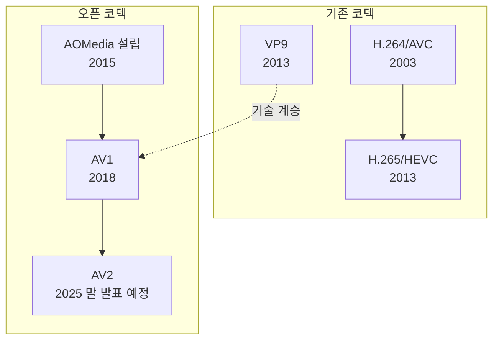
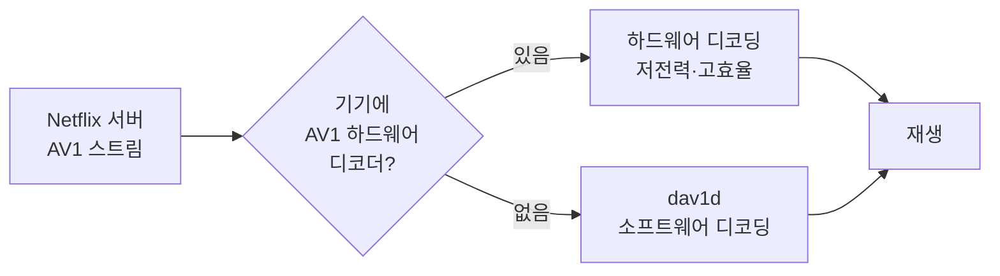

# Netflix 스트리밍의 30%를 차지한 AV1 정리

## 1. 한 줄 요약

AV1이 Netflix 전체 시청의 약 30%를 차지하며 H.264/AVC에 이어 2위
코덱이 되었고, 곧 1위가 될 전망이다. 대역폭은 줄이고 화질은 높였으며,
HDR10+·Film Grain Synthesis 같은 기능과 라이브·클라우드 게임 확장까지
이어진다.

## 2. 배경: AV1이란

- Netflix는 2007년 스트리밍 시작 이후 주로 H.264/AVC 사용
- 2015년 업계 리더들과 AOMedia(Alliance for Open Media) 공동 설립
- AV1은 AOMedia의 첫 대형 프로젝트
- 목표: 최신 코덱 대비 압축 효율 대폭 향상, 새로운 활용을 위한 풍부한 기능
- 3년 개발 후 2018년 공식 출시

### 2.1 코덱 기본 개념

코덱(codec)은 영상을 작게 압축(encode)하고 재생 시 복원(decode)하는
기술이다. 압축은 영상의 중복을 제거하는 방식으로 이루어진다.

- 공간 중복: 한 프레임 안의 비슷한 픽셀 (인트라 예측)
- 시간 중복: 이전·다음 프레임과 비슷한 부분 (인터 예측, 움직임 보상)
- 시각적으로 덜 중요한 정보: 변환·양자화로 제거


코덱이 새로워질수록 같은 화질에 필요한 비트레이트가 줄어든다. 대신
인코딩 연산량은 늘고, 재생 기기에 해당 코덱의 디코더가 필요하다.

### 2.2 AV1의 특징

- 오픈·로열티 프리: 특허 사용료 없이 누구나 구현 가능
  - H.264, HEVC는 특허 풀 라이선스가 필요하다.
- 여러 기술의 결합: Google VP9, Mozilla Daala, Cisco Thor 등의
  기술을 합쳐 만든 것으로 알려져 있다.
- 압축 효율: HEVC·VP9보다 높다 (원문 기준 Netflix 세션에서 대역폭 1/3 절감)
- 주요 기술 (개념)
  - 큰 블록(최대 128×128 슈퍼블록)과 다양한 블록 분할
  - 많은 인트라 예측 모드, 개선된 움직임 보상
  - 인루프 필터(디블로킹, CDEF, 루프 복원)로 압축 노이즈 감소
  - Film Grain Synthesis: 필름 입자를 파라미터로 전송 후 재합성
  - 레이어 코딩(스케일러빌리티), 화면 콘텐츠용 도구
- 단점
  - 인코딩 연산량이 크다 (초기에는 매우 느렸음)
  - 하드웨어 디코더가 없는 기기는 소프트웨어 디코딩(dav1d 등)에
    의존해 전력과 CPU 부담이 있다.

### 2.3 코덱 계보와 AOMedia



| 코덱 | 라이선스 | 비고 |
| --- | --- | --- |
| H.264/AVC | 특허 풀 | 가장 널리 호환, Netflix 1위 코덱 |
| HEVC | 특허 풀 | 4K/HDR에 많이 사용 |
| VP9 | 로열티 프리 | Google 주도 |
| AV1 | 로열티 프리 | AOMedia, 2018 출시 |

### 2.4 AV1 재생 경로



예시 (가상): 최신 스마트 TV는 하드웨어로 4K AV1을 낮은 전력으로 재생하고,
하드웨어 디코더가 없는 노트북 브라우저는 dav1d가 CPU로 디코딩한다.

## 3. Netflix의 AV1 여정

### 3.1 Android 모바일 (2020)

- 소프트웨어 디코더 dav1d를 통합 (ARM 칩셋에 최적화됨)
- 데이터 사용량에 민감한 모바일 사용자에게 효과적: 낮은 비트레이트에서
  더 선명하고 압축 노이즈가 적은 화질

### 3.2 TV·웹·Apple 기기로 확대

| 시기 | 내용 |
| --- | --- |
| 2019 | 기기 인증(certification) 항목에 AV1 추가 |
| 2021 말 | 스마트 TV (하드웨어 디코더, 제조사·SoC 업체와 인증 협력) |
| 2022 | 웹 브라우저 |
| 2023 | Apple M3, A17 Pro의 AV1 하드웨어 지원 |
| 2025-03 | AV1 HDR 스트리밍 시작 |
| 2025-07 | AV1 Film Grain Synthesis 제품화 |

### 3.3 효과

| 항목 | 결과 |
| --- | --- |
| 시청 비중 | 약 30% (2위 코덱, 곧 1위 예상) |
| VMAF | AVC 대비 +4.3, HEVC 대비 +0.9 (평균) |
| 대역폭 | AVC·HEVC 대비 1/3 절감 |
| 재생 끊김 | 45% 감소 |
| 콘텐츠 | 카탈로그 전 유형에서 개선 |

- 4K·고프레임레이트(HFR)처럼 높은 비트레이트가 필요한 경험을 더
  적은 데이터로 제공
- Open Connect(자체 CDN)와 ISP 파트너의 네트워크 부하 감소
  (회원 3억 명 이상, 글로벌 인터넷 트래픽의 무시 못 할 비중)

#### 예시 (가상): 2시간 영화의 데이터량

비트레이트 6 Mbps(AVC)를 AV1이 1/3 줄여 4 Mbps로 비슷하거나 더 나은
화질을 내는 경우.

```
AVC: 6 Mbps × 7200 s ÷ 8 = 5.4 GB
AV1: 4 Mbps × 7200 s ÷ 8 = 3.6 GB (1.8 GB 절감)
```

#### 예시 (가상): 네트워크가 느린 환경

가용 대역폭이 5 Mbps일 때 AVC 6 Mbps 스트림은 버퍼링이 잦지만, AV1
4 Mbps 스트림은 여유가 있어 끊김이 줄어든다. 이것이 "대역폭 1/3 절감
→ 끊김 45% 감소"가 연결되는 방식이다.

## 4. 고급 기능

### 4.1 HDR10+ (2025-03 시작)

- Netflix는 2016년부터 HDR 스트리밍 제공
- HDR10+를 선택한 이유: 동적 메타데이터로 장면별·기기별 톤 매핑 가능
- HDR 카탈로그의 85%(시청시간 기준)가 AV1-HDR10+, 몇 달 내 100% 예상

```
HDR10  : 영상 전체에 하나의 메타데이터 (정적)
HDR10+ : 장면마다 메타데이터 (동적) → 밝은 장면·어두운 장면 각각 최적화
```
